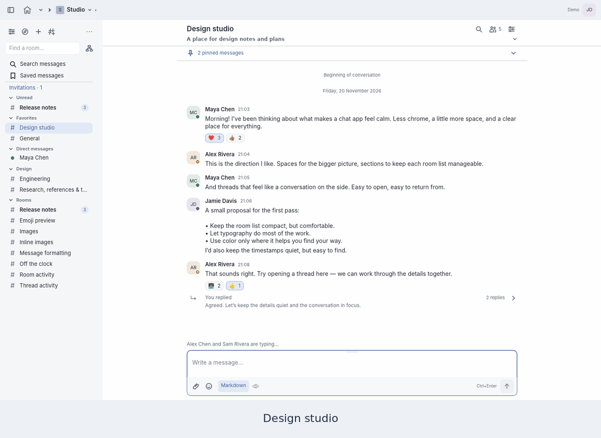
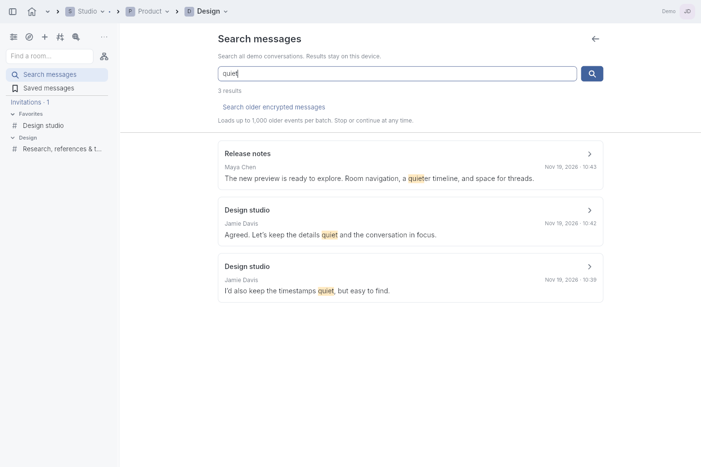

# Interconnect

<a href="docs/logo.svg">
  
</a>

A native desktop [Matrix](https://matrix.org/) client built with Rust,
[Iced](https://iced.rs/), and the [Matrix Rust SDK](https://github.com/matrix-org/matrix-rust-sdk).
Minimal UI, organized conversations, and event-driven updates to keep idle CPU low.

Fully AI-coded for personal use and shared as a working prototype. Developed on
Linux/Wayland; Apple Silicon macOS builds are experimental.


Keep a room and its thread open together, with separate composers and drafts.
All screenshots and the keyboard tour below use local demo data.

## A closer look

### Spaces without losing your place

Browse nested spaces through breadcrumbs, a tree menu, or a searchable picker.
Selecting a space filters the room list while keeping the open conversation,
thread, drafts, and reading positions. Include subspaces when you want a wider
view; arrange rooms into custom sections and reorder them by dragging.


### Navigate from the keyboard

Open a thread with **Alt+T**, pick a space with **Ctrl+Shift+P**, switch rooms
with **Ctrl+P**, and search messages with **Ctrl+Shift+F**. **Escape** takes you
back to the conversation. On macOS, use **Command** in place of **Ctrl**.



The 26-second loop pauses at each step. See [keyboard shortcuts](docs/keyboard.md)
for the full reference; the still images also show these views.

### More expressive conversations

Write Markdown and check an on-demand preview before sending. Messages support
syntax-highlighted code, LaTeX math, quotes, lists, spoilers, inline images, and
selectable text across messages. Complete user mentions, room links, and emoji
from the composer; manage personal and room custom emoji packs in Settings.
Text drafts persist encrypted per room and thread across restarts.


### Find the conversation again

Search loaded messages in a room or search across the account, combining local
results with homeserver search where available. Explicitly load older encrypted
history in batches when you need to look further; results depend on available
room keys. Open a result at its original room or
thread, or bookmark messages for an account-wide saved view.



## Other features

- Password and browser SSO login, saved sessions, encrypted messaging, and device
  verification.
- Replies, editing, confirmed deletion, reactions, pinned messages, and read receipts.
- Images and an image viewer, click-to-play GIFs, and attachments via file picker,
  paste, or drag and drop, with save/open actions.
- Direct chats, room and space creation, public-room discovery, invitations,
  member roles, room/space avatars, and notification/access settings.
- Keyboard navigation and quick switching, light/dark themes, desktop
  notifications, and optional presence refresh (off by default).

See [current limitations](docs/limitations.md) for unsupported features and
[settings](docs/settings.md) for configuration and room/space management.

## Try it

Install Rust and the [native dependencies](docs/development.md#build-and-checks), then:

```sh
cargo run --locked --bin interconnect -- --demo
```

Demo uses local sample data without saved accounts or network access. Omit `--demo`
to sign in; the homeserver must support native sliding sync. Account storage
requires Linux Secret Service or macOS Keychain. One account is supported per
process; calls and recovery/key-backup UI are not available yet.

Tagged GitHub Releases provide an amd64 Debian package, a Linux tarball, an
Apple Silicon macOS app, and checksums. See [release downloads and installation](docs/development.md#tagged-releases).
Experimental [Debian packages](docs/development.md#debian-package-automation) and
[macOS builds](docs/development.md#download-a-bleeding-edge-macos-build) are also
available from GitHub Actions. macOS builds are ad-hoc signed and not notarized.

See [documentation](docs/README.md) and [keyboard shortcuts](docs/keyboard.md).

## License

[MIT](LICENSE); dependencies and assets retain their
[own licenses](THIRD_PARTY_NOTICES.md).
