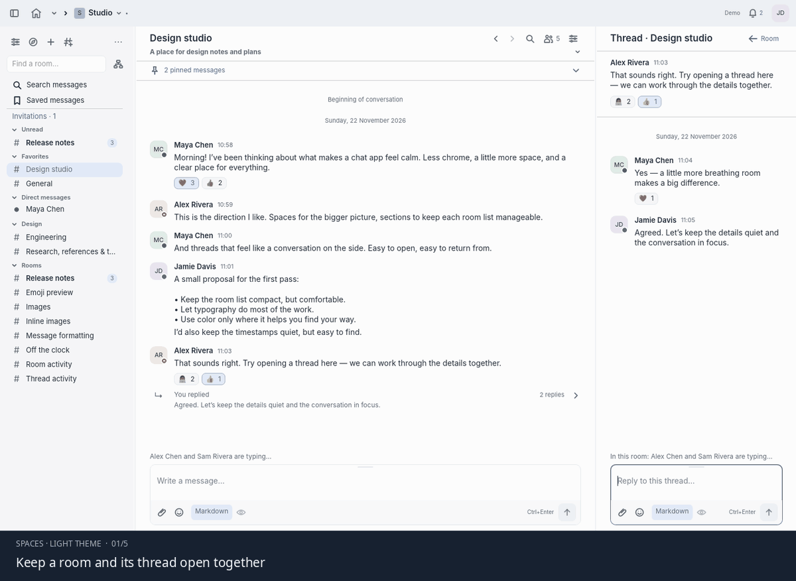
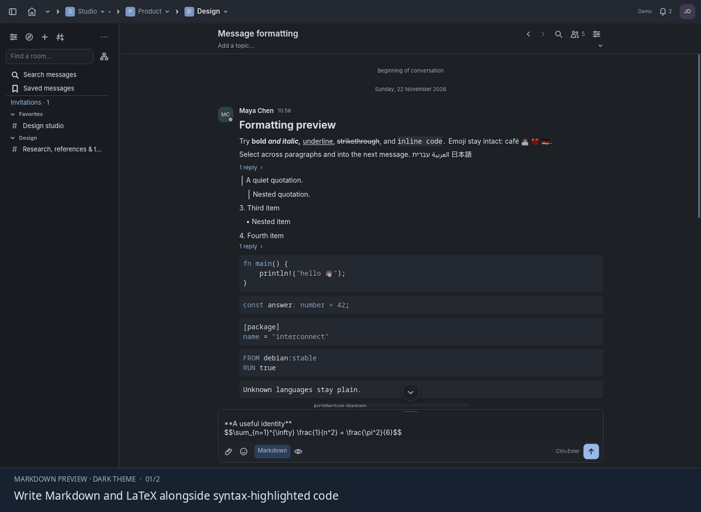
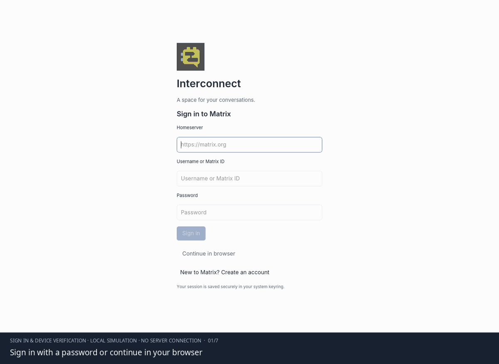

# Interconnect

[](https://matrix.to/#/#interconnect:mpi-sws.org)

<a href="docs/logo.svg">
  
</a>

A native desktop [Matrix](https://matrix.org/) client built with Rust,
[Iced](https://iced.rs/), and the [Matrix Rust SDK](https://github.com/matrix-org/matrix-rust-sdk).

- **Lightweight and native.** No bundled browser engine; event-driven updates
  keep idle CPU use low.
- **Organization for busy accounts.** Deeply nested and linked spaces, custom
  room sections, bookmarks, and unread activity in one place.
- **Keyboard-first navigation.** IDE-style quick pickers and conversation
  back/forward history that remembers your room, thread, and reading position.
- **Made for technical conversations.** Markdown tables, syntax-highlighted code
  with bounded previews and Copy/Save, rendered LaTeX formulas, and custom emoji
  and reactions.

Experimental and fully AI-coded for personal use. Developed on Linux/Wayland;
Apple Silicon macOS builds are best-effort.


## Make room for your conversations

Keep a room and its thread open side by side, with separate composers and drafts.
Browse spaces without closing either: breadcrumbs, a tree, and searchable pickers
make even deeply nested spaces easy to reach.



Switch conversations, jump to unread rooms, search across your account, and retrace
your steps from the keyboard. Text drafts persist encrypted across restarts.


Write code, tables, and math, then preview before sending. Long code blocks start
with a bounded preview: use the corner icons to expand/collapse, copy, or save,
and the horizontal scrollbar for wide lines. Size message text independently
from the interface in Settings → General. Select and copy across messages;
bookmark the ones you want to find again.



Images use local demo data and predate the current code controls. See
[code blocks](docs/keyboard.md#code-blocks),
[Markdown tables](docs/keyboard.md#markdown-tables),
[keyboard shortcuts](docs/keyboard.md), [settings](docs/settings.md), and
[current limitations](docs/limitations.md) for the implemented behavior.

## Get started

Download a package from [GitHub Releases](https://github.com/FreakyPenguin/interconnect/releases):
an amd64 Debian package, Linux tarball, or Apple Silicon macOS app.
See [installation details](docs/development.md#tagged-releases);
macOS builds are ad-hoc signed and not notarized.

Or install Rust and the [native dependencies](docs/development.md#build-and-checks),
then explore without an account:

```sh
cargo run --locked --bin interconnect -- --demo
```

Demo mode uses no saved accounts or network access. Omit `--demo` to sign in.
Your homeserver must support native sliding sync; account storage requires Linux
Secret Service or macOS Keychain. Use `--profile work` for a separate
[account profile](docs/settings.md#account-profiles), with one account per process.

### Sign in and verify

Sign in with a password or continue in your browser, then verify with another
Matrix client on the same account. Compare **every emoji or number on both
devices** before confirming. New accounts are offered recovery-key setup.



This tour simulates sign-in and verification without connecting to a server.
See [device verification](docs/validation/verification.md) and
[key backup and recovery](docs/validation/recovery.md) for the live workflows.

More in the [documentation](docs/README.md).

## License

[MIT](LICENSE); dependencies and assets retain their
[own licenses](THIRD_PARTY_NOTICES.md).
