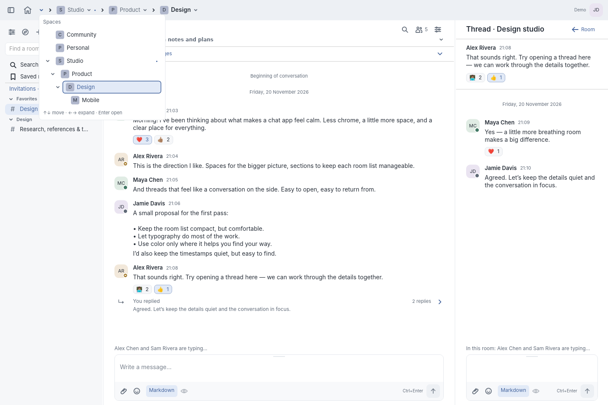
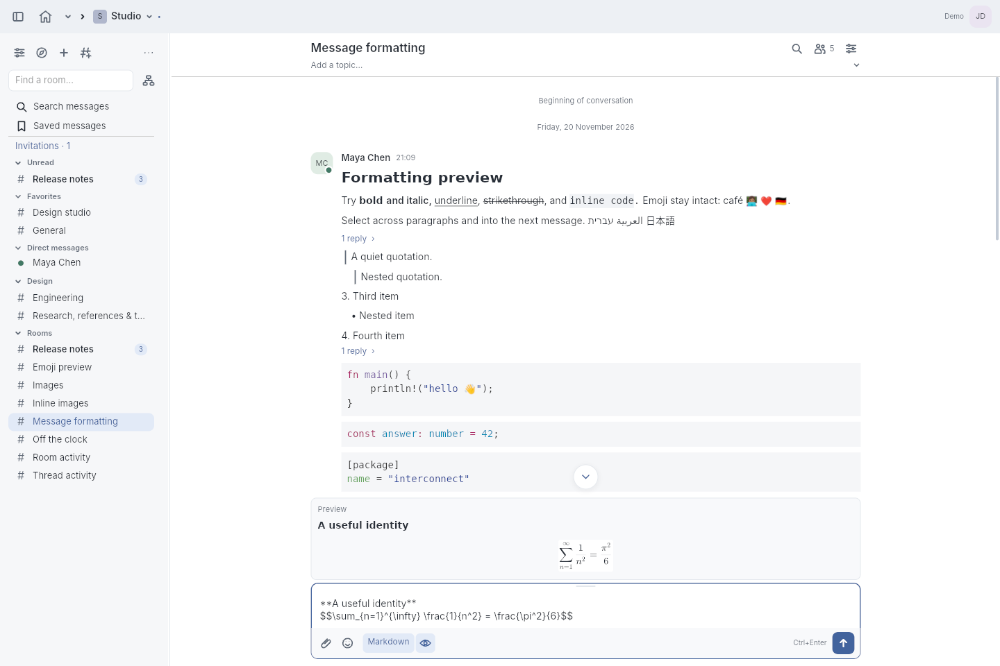

# Interconnect

[](https://matrix.to/#/#interconnect:mpi-sws.org)

<a href="docs/logo.svg">
  
</a>

A native desktop [Matrix](https://matrix.org/) client built with Rust,
[Iced](https://iced.rs/), and the [Matrix Rust SDK](https://github.com/matrix-org/matrix-rust-sdk).
Minimal UI, organized conversations, and event-driven updates to keep idle CPU low.

An experimental client, fully AI-coded for personal use. Developed on
Linux/Wayland; Apple Silicon macOS builds are experimental.


Keep a room and its thread open together, with separate composers and drafts.
All screenshots and GIFs below use local sample data.

## In development for 0.4.0

- Follow reply previews to their originals, then use conversation back/forward
  history to return to the room, thread, and reading location you left.
- Restore room/thread reading positions across restarts using encrypted event
  anchors. Restoration depends on available history and room keys.
- More dependable composer focus when opening threads and returning from saved
  messages or message menus.
- Follow system appearance and enlarge text and controls together with interface
  sizes from 100% to 150%.
- Cancel queued messages and uploads, with confirmation explaining the case where
  a send is already in flight.
- Manage ignored users in Account settings, or open those controls from People.
- Click message, invitation, and verification notifications. The toolbar bell
  brings unread activity together with encrypted recent notification history.
- Message jumps briefly highlight their destination, including reply previews,
  notifications, and Matrix links to text or file messages.

See [validation guidance](docs/validation/connected-ui.md) for automated coverage
and connected desktop checks that still need manual validation.

## New in 0.3.0

- Account registration, recovery-key setup/import/replacement, and a verification
  prompt after sign-in. Verified devices can request recent room keys in one
  bounded background pass.
- Account display-name/avatar editing, room addresses and directory publishing,
  and navigation from replaced rooms to their successors.
- Markdown topics, reorganized settings, keyboard-accessible dialogs, and
  protection for unsaved changes.
- Named account profiles and HTTP/HTTPS/SOCKS proxy support.

## A closer look

### Sign in and verify your device

Sign in with a password or continue in your browser, then verify the new device
with another Matrix client on the same account. Compare every emoji or number
on both devices before confirming.


This tour simulates sign-in and verification locally; it does not connect to a
homeserver. See [device verification](docs/validation/verification.md) for the
live workflow and validation steps.

### Spaces without losing your place

Browse nested spaces through breadcrumbs, a tree menu, or a searchable picker.
Selecting a space filters the room list while keeping the open conversation,
thread, drafts, and reading positions. Include subspaces when you want a wider
view; arrange rooms into custom sections and reorder them by dragging.



### Navigate from the keyboard

Open a thread with **Alt+T**, pick a space with **Ctrl+Shift+P**, switch rooms
with **Ctrl+P**, and search messages with **Ctrl+Shift+F**. **Escape** takes you
back to the conversation. On macOS, use **Command** in place of **Ctrl**.


See [keyboard shortcuts](docs/keyboard.md) for the full reference.

### More expressive conversations

Write Markdown and check an on-demand preview before sending. Messages support
syntax-highlighted code, LaTeX math, quotes, lists, spoilers, inline images, and
selectable text across messages. Complete user mentions, room links, and emoji
from the composer; manage personal and room custom emoji packs in Settings.
Text drafts persist encrypted per room and thread across restarts.



### Find the conversation again

Search loaded messages in a room or search across the account, combining local
results with homeserver search where available. Explicitly load older encrypted
history in batches when you need to look further; results depend on available
room keys. Open results in their original room/thread, or bookmark messages
for an account-wide saved view.


## Other features

- Password and browser SSO login, saved sessions, encrypted messaging, device
  verification, and key backup/recovery.
- Replies, editing, confirmed deletion, reactions, pinned messages, and read receipts.
- Images and an image viewer, click-to-play GIFs, and attachments via file picker,
  paste, or drag and drop, with save/open actions.
- Direct chats, room and space creation, public-room discovery, invitations,
  member roles, room/space avatars, published addresses, and notification/access settings.
- Keyboard navigation and quick switching, light/dark themes, desktop
  notifications, and optional presence refresh (off by default).

See [current limitations](docs/limitations.md) for unsupported features and
[settings](docs/settings.md) for configuration and room/space management.

## Try it

Install Rust and the [native dependencies](docs/development.md#build-and-checks), then:

```sh
cargo run --locked --bin interconnect -- --demo
```

Demo uses local sample data without saved accounts or network access. Omit `--demo`
to sign in; the homeserver must support native sliding sync. Account storage
requires Linux Secret Service or macOS Keychain. One account is supported per
process. New accounts are offered recovery-key setup;
existing accounts can manage [key backup and recovery](docs/validation/recovery.md)
from the account menu.

Use `--help` to list options, `--profile work` for a named profile in the regular
data directory, or `--profile-path /path/to/profile` for an explicit directory.
See [account profiles](docs/settings.md#account-profiles) for storage details.

Tagged GitHub Releases provide an amd64 Debian package, a Linux tarball, an
Apple Silicon macOS app, and checksums. See [release downloads and installation](docs/development.md#tagged-releases).
Experimental [Debian packages](docs/development.md#debian-package-automation) and
[macOS builds](docs/development.md#download-a-bleeding-edge-macos-build) are also
available from GitHub Actions. macOS builds are ad-hoc signed and not notarized.

See [documentation](docs/README.md) and [keyboard shortcuts](docs/keyboard.md).

## License

[MIT](LICENSE); dependencies and assets retain their
[own licenses](THIRD_PARTY_NOTICES.md).
