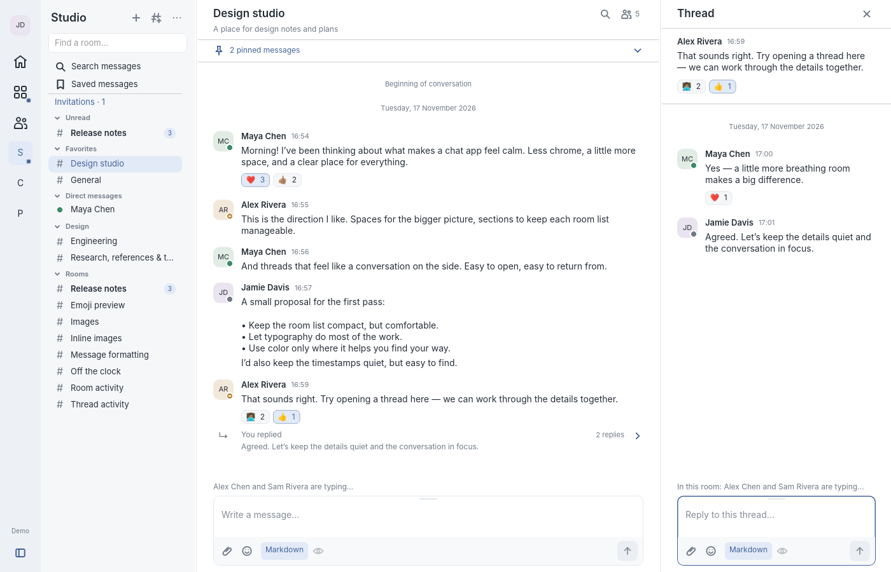

# Interconnect

<a href="docs/logo.svg">
  
</a>

A native desktop [Matrix](https://matrix.org/) client built with Rust,
[Iced](https://iced.rs/), and the [Matrix Rust SDK](https://github.com/matrix-org/matrix-rust-sdk).
Minimal UI, organized conversations, and event-driven updates to keep idle CPU low.

Fully AI-coded for personal use and shared as a working prototype. Developed on
Linux/Wayland; Apple Silicon macOS builds are experimental.



## Features

- Password/SSO login, saved sessions, encrypted messaging, and device verification.
- Nested spaces, custom room sections, quick switching, and keyboard navigation.
- Room/thread panes, encrypted text drafts, Markdown/math, mentions, reactions,
  and custom emoji packs.
- Message search, saved messages, editing, replies, and deletion.
- Images, click-to-play GIFs, attachments via picker/paste/drop, and save/open.
- Room/space creation and discovery, invitations, member management, and settings.
- Desktop notifications, light/dark themes, and optional presence refresh.


## Try it

Install Rust and the [native dependencies](docs/development.md#build-and-checks), then:

```sh
cargo run --locked --bin interconnect -- --demo
```

Demo uses local sample data without saved accounts or network access. Omit `--demo`
to sign in; the homeserver must support native sliding sync.

Experimental [Debian packages](docs/development.md#debian-package-automation) and
[macOS builds](docs/development.md#download-a-bleeding-edge-macos-build) are available
from GitHub Actions. macOS builds are ad-hoc signed and not notarized.

See [documentation](docs/README.md), [shortcuts](docs/keyboard.md), and
[current limitations](docs/limitations.md).

## License

[MIT](LICENSE); dependencies and assets retain their
[own licenses](THIRD_PARTY_NOTICES.md).
